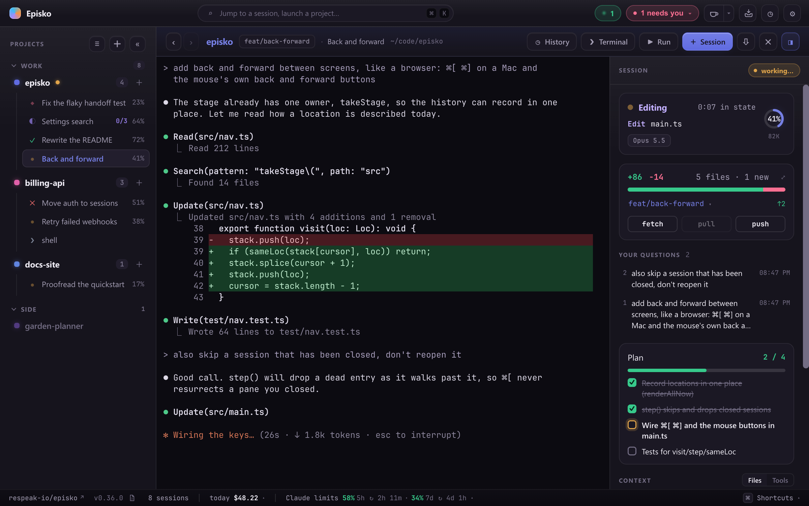
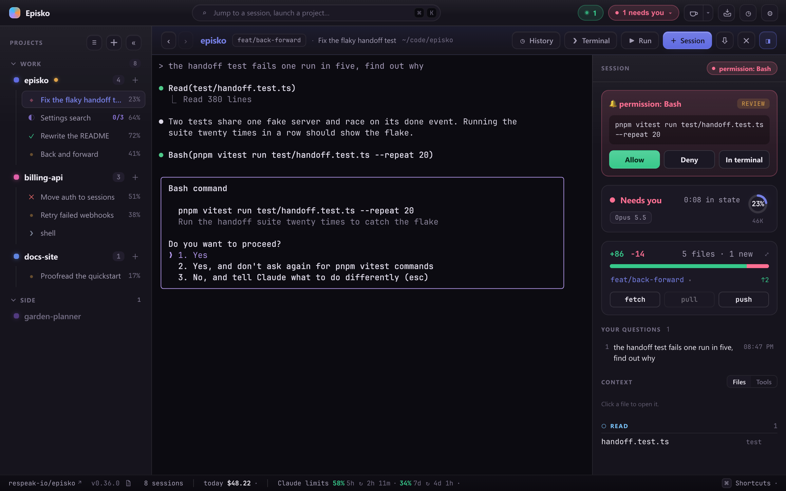
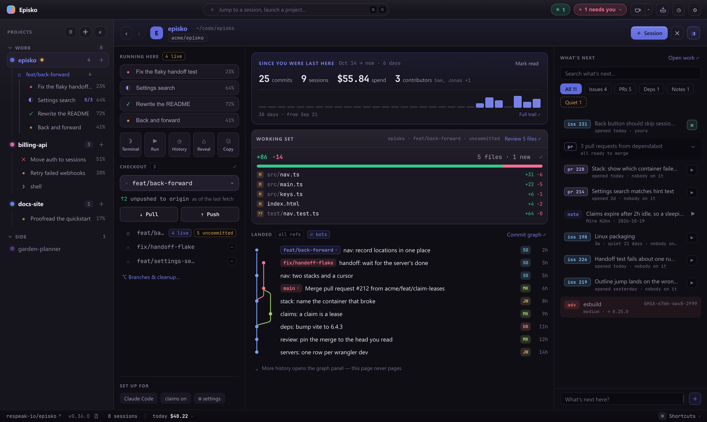
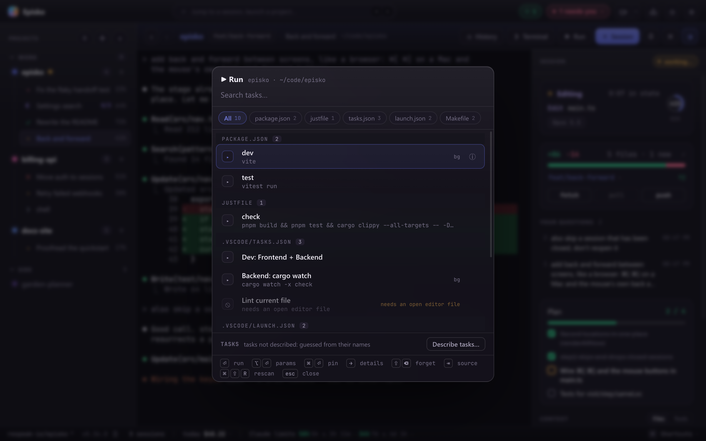
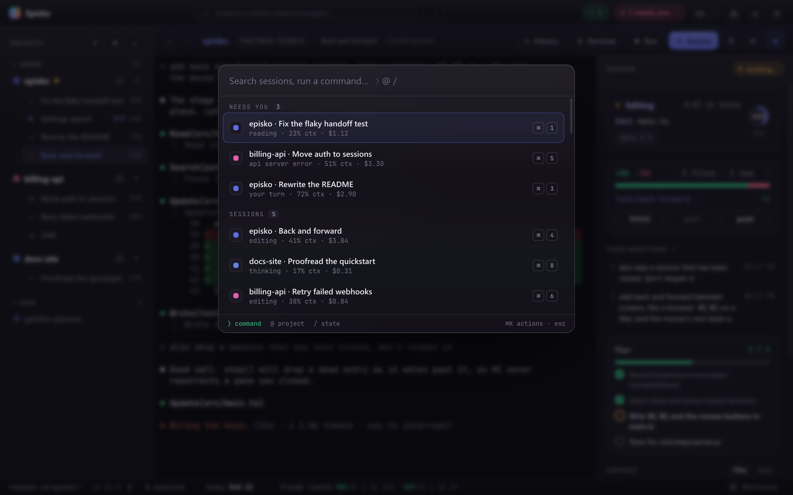
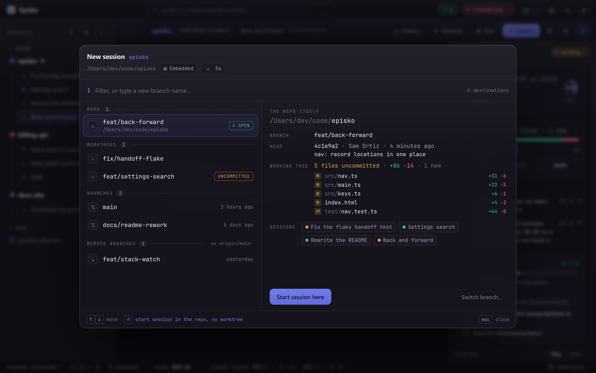
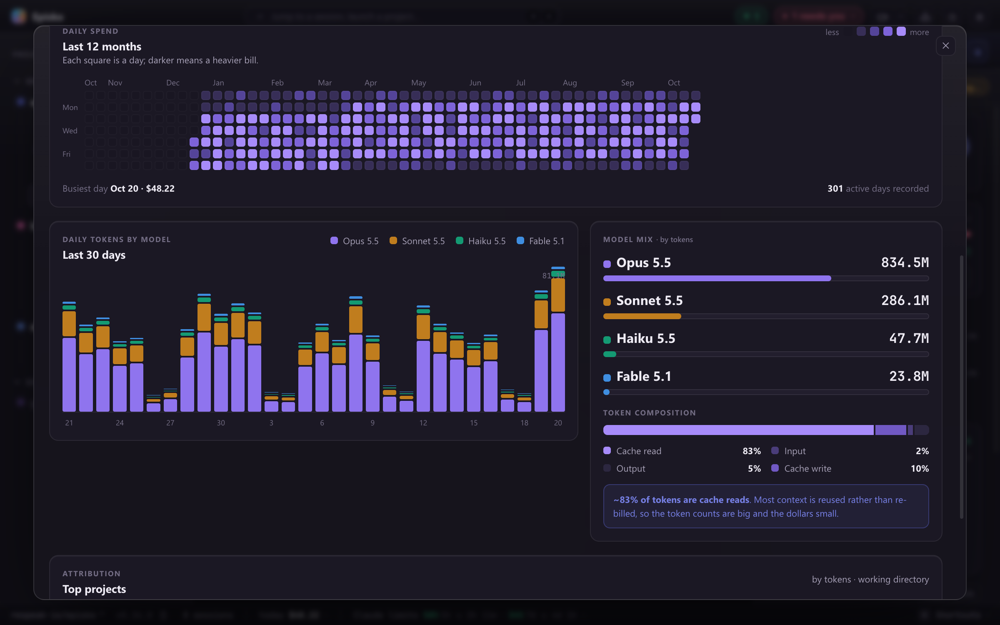

# Episko



Episko is a desktop app for running a lot of coding agents at once. Every session is the agent's own TUI in a real terminal, and beside each one Episko shows what that agent is doing right now: thinking, editing a file, waiting on your permission, done or failed. Whatever needs you floats to the top of the sidebar, so with eight sessions across four repos you still know which one to look at next.

Claude Code and Codex are integrated: Episko reads their live state, answers their permission prompts and tracks their usage. Twenty more agent CLIs (OpenCode, Gemini, Cursor, Copilot, Amp, Qwen, Kimi and others) run in the same panes as plain terminals. The name is the Greek *episkopos*, the one who watches over.

**[episko.dev](https://episko.dev)** · [Download](https://github.com/respeak-io/episko/releases/latest) · macOS + Windows · free and open source

> Status: early, but in daily use. Internals move fast and you will find rough edges.


## What makes it different

### It hears every agent directly

Episko doesn't scrape terminal output to guess what an agent is doing. For each Claude launch it writes a throwaway `--settings` file whose hooks and status line POST every lifecycle event to a small HTTP server inside the app. Each event carries an id Episko chose before the process started, so the right pane lights up before Claude prints anything, and it stays routed through `/clear`, `/compact` and `/resume`, which all hand Claude a new session id. Nothing in `~/.claude` is modified to make this work, and the settings file goes away with the session. Codex runs against a loopback App Server that Episko and the real `codex --remote` TUI both connect to.

Permission requests use the one hook that blocks. The server holds Claude's request open while you read the command in Episko and pick Allow, Deny or *In terminal*, so an agent that needs a yes doesn't wait twenty minutes in a tab you weren't watching. Episko also chimes when one arrives, which helps when its window is behind your editor.

### It finds the dev servers your agents forget to mention

Agents start `pnpm dev` in a background shell and carry on. Episko reads that shell's log for the URL, and it also walks every listening TCP port on the machine back up the process tree to the pane that owns it. A server shows up in the header whether anyone announced it or not, including one you started by hand in a shell pane. Debugger and control sockets are filtered out, so one `wrangler dev` is one row. A server that dies on `EADDRINUSE` two seconds in turns the pill red and stays listed until you dismiss it. Stop asks the agent that started the server to run `TaskStop`, so the agent knows it is gone.

Start `just dev` and the popover goes a step further: the task's panes and the repo's Docker Compose containers show as one stack with one state. *Starting* names what it is still waiting for, *failed* names the step or container that broke, and *ready* means every server listens and every health check is green.

### It gets the overnight run going again

A 529 at 3 a.m. ends the turn, and the session sits at its prompt until you're back. Turn on *Carry on after an API error* and Episko sends the carry-on itself, on a backoff ladder you configure (the defaults ride out about half an hour of outage). Each wait gets some jitter, so sessions knocked out by the same outage don't all come back in the same second. It never types into a session that is asking you something, doesn't retry what waiting can't fix (credentials, billing, a malformed request), and holds its attempts while the machine is offline.

### It reviews what the agent wrote

The working-set diff reads like a pull request. Changed lines are paired by similarity, so an edit with three new comment lines above it still lines up with its original, and only the words that changed are marked. Each file gets a row of findings: code you just added that already exists elsewhere in the project (six lines or more, with the file and line it copies), a new empty `catch`, `as any` or `@ts-ignore`, the complexity and nesting of the functions the change went into, and whether any test changed. Nothing blocks and nothing is scored. *Copy findings* puts the list on the clipboard written for an agent, so the session that wrote the code can fix it. You can commit, stash or discard from the same view, down to a single hunk.

### Pull requests and issues, wired to agents

A GitHub pull request opens on a stage of its own: the diff against the merge base, review threads on their lines, a `+` wherever GitHub will take a comment, and a pending review that goes out in one Submit. The merge is pinned to the head you reviewed. *→ agent* hands a thread, or your whole pending review, to a session on the PR's branch in its own worktree.

From the project dashboard, ▶ on an issue opens a dispatch sheet. Choose where the agent works (this folder, an existing worktree, or a new one on its own branch), read the prompt and send it. Episko writes a claim on the issue so a colleague's agent doesn't start the same work. The claim is a lease: it expires, and it ends with the session.

### Hand a session to another machine

Episko can sync through a server you run yourself, one binary and one SQLite file (or `docker compose up`). With handoff switched on there, *Send to…* stops a Claude session, drafts a short brief and sends the conversation along with the code it was working on. The other machine, yours or a teammate's, reads the brief, picks a checkout and resumes, and the code lands in a new worktree. Nothing is installed until the server confirms the session has changed hands, and permission modes never travel. The send sheet reminds you every time that a transcript carries whatever the agent read.

The same server carries your settings, spend, limits and Claude's project memories between your own machines. Nothing else in Episko depends on it.

### Limits you see coming

The footer forecasts your 5-hour and weekly windows from your burn rate and turns amber, then red, before you run out. A premium model's separate weekly allowance (Fable's, for example) isn't in any telemetry, so Episko asks the Claude CLI for it directly, which costs no tokens. Spend is broken down by day, model and project, and by machine once you sync.

### Click a question to go back to it

The inspector lists every prompt you sent a session. Click one and the terminal scrolls back to where you asked it. That works in Claude's fullscreen renderer too, which has no scrollback a terminal can move: there Episko pages the TUI with its own keys until your question is on screen. A resumed session gets its questions back from the transcript.

### It follows an agent that wanders off

When an agent starts writing in a different worktree mid-task, Episko switches the header, the working set and the git buttons to that checkout. The session row still says where it started (*from dev*), and *Move session here* re-homes the conversation if it should stay.

### Your project's tasks, in the same panes

Episko finds the tasks a repo already defines: `.vscode/tasks.json` and `launch.json`, `package.json` scripts, a `justfile`, `Taskfile.yml`, `mise.toml`, a `Makefile`, `Cargo.toml`. A run is a session like any other, and its exit code is its status. Finding them never executes the project: tools whose listing evaluates code wait until you trust the repo, and a task that can't run is listed with the reason. *Run on stop* starts the tests, or anything else, whenever an agent finishes a turn. Switch on Episko's MCP server and a Claude session can run those tasks itself, each in its own pane beside the session where you can watch it.

## Also in the box

- A dashboard for every project: what moved since you last looked, the working set, a small commit graph across branches, and one ranked list of issues, pull requests, Dependabot advisories and notes. Another one covers all your projects at once.
- Each day's commits summarised in a sentence by Haiku, through your own `claude` CLI. It's opt-in per project, and the team can share one log by committing it as `.episko/digest.md`.
- Branches in one table wherever their refs live, with sweeps for merged, gone and stale ones. The default branch and locked branches can't be deleted from it.
- Auto-fetch for the checkout on screen, so "2 behind" is current.
- History of every Claude and Codex session on the machine, searchable and resumable. Claude sessions running in another terminal show up live and read-only, with a jump to that terminal.
- Sessions resume after a restart, and a webview reload re-adopts the running processes with their scrollback.
- `⌘K` palette, `⌘P` file finder, `⌘T` shell beside the agent, back and forward between screens. Every shortcut can be rebound.
- Sounds for the moments that matter, gated so six sessions finishing together make one sound.
- Paths in any pane become links once Episko has found the file on disk, and Markdown opens in a built-in reader.

## How it's built

[Tauri v2](https://tauri.app/) with a Rust backend and a vanilla TypeScript frontend, no framework. PTYs come from [portable-pty](https://crates.io/crates/portable-pty) (forkpty on macOS, ConPTY on Windows), the telemetry listener is [tiny_http](https://crates.io/crates/tiny_http), and terminals render with [xterm.js](https://xtermjs.org/). CI runs over 2,000 frontend tests and over 400 Rust tests on macOS and Windows. There is no Episko cloud: the only server is the optional sync server you host.

[`CLAUDE.md`](./CLAUDE.md) is the architecture document, with the module maps and the invariants that keep the app working. The per-area design notes in [`docs/`](./docs/) include the bugs that shaped each rule. [`SPIKE.md`](./SPIKE.md) is the original single-session prototype, kept as history.

## Install

Grab the latest build from the [Releases page](https://github.com/respeak-io/episko/releases/latest). Install [Claude Code](https://claude.com/claude-code), Codex, or another supported coding-agent CLI on your `PATH`; Claude remains the default until you choose another provider.

### macOS (Apple silicon)

Episko is self-signed but **not notarized through Apple**, so Gatekeeper quarantines the download and refuses to open it (*"… is damaged and can't be opened"*). Clear the quarantine flag **before** opening the `.dmg`:

```sh
xattr -dr com.apple.quarantine ~/Downloads/Episko_*.dmg
```

Then open it, drag **Episko** into Applications, and launch. If it's still blocked on first launch, run the same command on the installed app:

```sh
xattr -dr com.apple.quarantine /Applications/Episko.app
```

### Windows (10 / 11)

Download the `.msi` (or the `.exe` installer) and run it. SmartScreen may warn on first run; choose *More info ▸ Run anyway*.

Episko keeps itself current after install: it checks the latest GitHub release on launch and offers an in-app update. It never installs one behind your back, since a restart would kill your running sessions.

## Build from source

### Prerequisites

- [Node.js](https://nodejs.org/) 24+ (`.nvmrc` pins the version CI uses) and [pnpm](https://pnpm.io/)
- [Rust](https://www.rust-lang.org/tools/install) (stable) + the [Tauri system dependencies](https://tauri.app/start/prerequisites/) for your platform
- At least one supported coding agent on your `PATH` ([Claude Code](https://claude.com/claude-code), Codex, or a terminal-only provider)

### Run it

```sh
pnpm install          # first time
pnpm tauri dev        # run the app
pnpm tauri build      # production bundle
```

Then add a project folder, hit **＋ Session**, accept Claude's workspace-trust prompt the first time in a directory, and ask it something. The sidebar glyph, inspector and footer update as it works.

Other useful commands:

```sh
pnpm exec tsc --noEmit    # typecheck (strict; this is the real linter)
pnpm test                 # vitest: frontend unit tests
cd src-tauri && cargo test
```

> Run dev builds from a **real terminal**, not from a terminal pane inside Episko, because anything started inside Episko becomes its descendant and gets filtered out of the external-session list.

## Platform support

| | macOS | Windows | Linux |
|---|---|---|---|
| Embedded terminal | ✅ | ✅ | — |
| Ghostty / Terminal / iTerm2 | ✅ | — | — |
| Telemetry, permissions, usage | ✅ | ✅ | — |
| External-session discovery | ✅ | ✅ | untested |
| Jump to a session's terminal | ✅ tab | ✅ window | — |

Release builds target Apple silicon (`aarch64`) and Windows x64. Intel Macs aren't covered; Linux isn't packaged, though the non-`ps` paths are written to be OS-agnostic.

## More screenshots

<sub>Rendered from the app itself, with made-up projects and sessions.</sub>

A permission request in the inspector: the command, how risky it looks, and Allow, Deny or In terminal.



Every project has a page of its own: the sessions and checkouts on the left, what moved since you last looked in the middle, and one ranked list of what's next on the right.



The ▶ Run picker, grouped by where each task came from. A task that can't run says why.



`⌘K` jumps anywhere, with whatever needs you ranked first.



Start a session on any branch or worktree, or create one on the spot, with a preview of HEAD and what's uncommitted.



Where the money and tokens went: a year of daily spend, tokens by model, and how much of it was cache reads.



## License

[MIT](./LICENSE) © Respeak GmbH, Karlsruhe

Episko is an independent project, not affiliated with, endorsed, or sponsored by the agent providers it supports. Product names and logos belong to their respective owners. Claude and Claude Code are trademarks of Anthropic, PBC.
